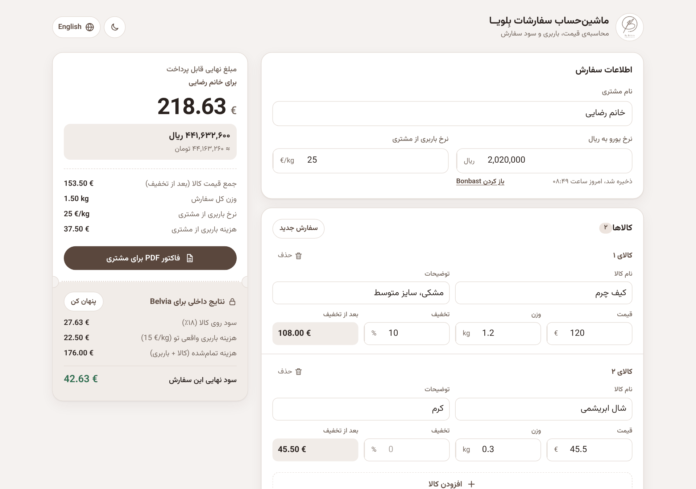
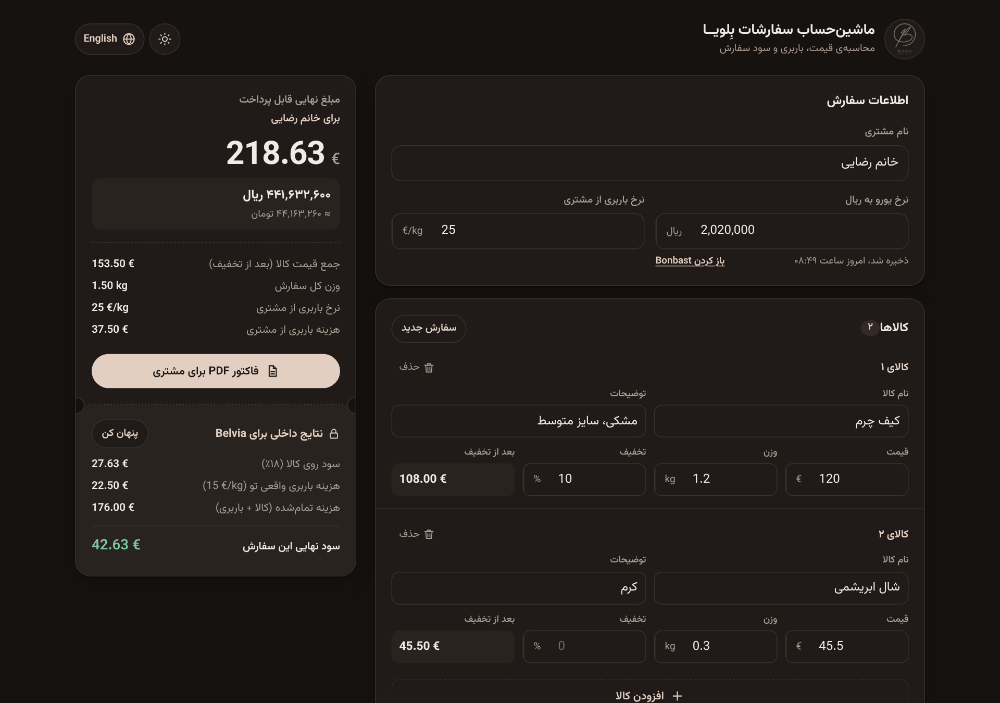
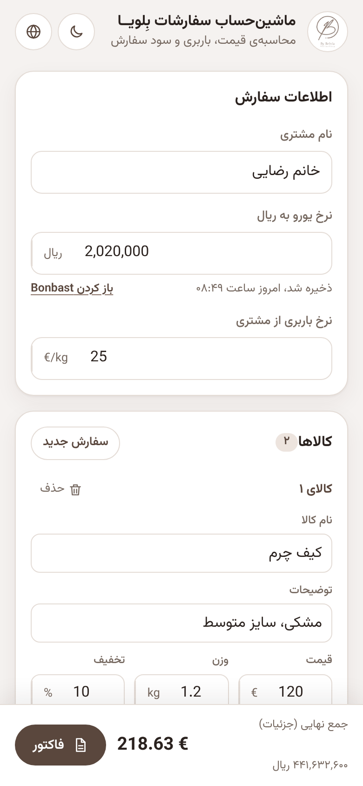
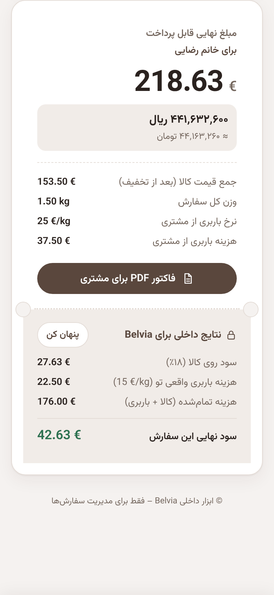

# Belvia Order Calculator

An internal tool for **Belvia Online Shop** that works out the final price of a customer order: product prices in euros, discounts, shipping by weight, the amount in Rial and Toman, and Belvia's own profit. It also creates a printable PDF invoice for the customer.

Live at **[armannss.github.io](https://armannss.github.io)**. It works in any browser and can be installed on a phone's home screen as an app.

## What's new in version 2

This version is a full redesign of the calculator. The pricing formulas are the same, so an order adds up to exactly what it did before.

- **New look.** Colours come from the Belvia logo, and there are light and dark themes. The first time it opens, it uses the phone's theme setting.
- **Live totals.** Totals update as you type. The *set rate*, *create rows* and *calculate* buttons are gone.
- **Product cards.** Products are added and removed one at a time, and each card shows its price after discount. Phones no longer need a sideways-scrolling table. Pressing Enter on the last product adds a new one.
- **Receipt-style summary.** The final amount is shown in euros, Rial and Toman.
- **Private profit section.** The internal profit section can be hidden before you show the screen to a customer.
- **Mobile total bar.** On phones, the final total and the invoice button stay at the bottom of the screen.
- **Nothing lost on refresh.** The EUR rate, shipping rate and the order you're working on are saved. If the saved EUR rate isn't from today, a warning appears.
- **Persian digits.** Number fields accept Persian digits (`۱۲٫۵` works the same as `12.5`).
- **English mode.** Switching to English also switches the layout to left-to-right.
- **Cleaner invoice.** One template for both languages, the EUR rate shown once instead of on every row, and better print layout.
- **No login page.** The login page has been removed; the calculator opens directly.
- **Label fix.** The English margin label now says 18%, which is what the calculation uses.

## Screenshots

| Desktop (light) | Desktop (dark) |
| --- | --- |
|  |  |

| Mobile: order form | Mobile: summary |
| --- | --- |
|  |  |

## How to use it

1. Enter the customer's name.
2. Enter today's EUR → Rial rate. The **Open Bonbast** link opens [bonbast.com](https://www.bonbast.com/) to check it.
3. Check the customer shipping rate (default **25 €/kg**).
4. Add each product with its price in euros, its weight in kg and any discount.
5. Read the totals in the summary, then tap **Customer PDF invoice** to print the invoice or save it as a PDF.
6. Tap **New order** to clear the form for the next customer. The rates are kept.

## How the price is worked out

| Item | Formula |
| --- | --- |
| Goods total | Σ price × (1 − discount %) |
| Customer shipping | total weight × customer rate (default 25 €/kg) |
| Margin on goods | goods total × 18% |
| **Final price (customer)** | goods total + margin + customer shipping |
| Final price in Rial | final price × EUR rate |
| Real shipping cost | total weight × 15 €/kg |
| Total internal cost | goods total + real shipping cost |
| **Final profit** | final price − total internal cost |

The 18% margin, 15 €/kg real shipping cost and 25 €/kg default rate are set at the top of the script in `index.html` (`PROFIT_RATE`, `OUR_SHIP_RATE`, `DEFAULT_SHIP_RATE`).

## Files

| File | Purpose |
| --- | --- |
| `index.html` | The whole app: layout, styles, calculations and invoice |
| `manifest.json` | Lets the app be installed on a phone's home screen |
| `service-worker.js` | Required for installing as an app |
| `Brown.png` | Belvia logo and app icon |
| `screenshots/` | Images used in this README |

It's plain HTML, CSS and JavaScript, with no build step. GitHub Pages serves the `main` branch as-is, so changes go live a minute or two after they're pushed.

---

Designed and built by **Arman Naseri Far** for Belvia Online Shop.
